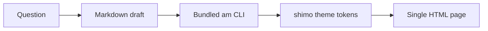

<p align="right">
  <strong>English</strong> · <a href="./README.zh-CN.md">简体中文</a>
</p>

<p align="center">
  
</p>

<h1 align="center">Answer me with HTML<br>in Shimo Style</h1>

<p align="center">
  <b>An agent skill that answers hard questions with a one-page HTML in Shimo Docs style.</b><br>
  <sub>Markdown in. One self-contained page out. No server, no build step.</sub>
</p>

<p align="center">
  <a href="https://github.com/kanzakivnw/answer-me-with-html-in-Shimo-Style/releases"></a>
  <a href="https://github.com/kanzakivnw/answer-me-with-html-in-Shimo-Style/blob/main/LICENSE"></a>
  
  
  <a href="https://kanzakivnw.github.io/answer-me-with-html-in-Shimo-Style/"></a>
</p>

<p align="center">
  <a href="https://kanzakivnw.github.io/answer-me-with-html-in-Shimo-Style/"><b>Demo</b></a> ·
  <a href="#-install"><b>Install</b></a> ·
  <a href="#-the-shimo-look"><b>Theme</b></a> ·
  <a href="#-development"><b>Development</b></a>
</p>

<p align="center">
  
</p>

<p align="center">
  <sub>The built-in <code>shimo</code> theme. Run <code>am config set mode dark</code>, or use the page toolbar, for the dark variant.</sub>
</p>

## Why this fork?

[Answer me with HTML](https://github.com/QingYunA/answer-me-with-html) already turns a Markdown draft into one clean HTML
page. This fork adds a **project-native Shimo Docs theme** and makes it the default, so every page looks like a document
someone would actually read.

| | Original | This fork |
| :--- | :--- | :--- |
| CLI, drafts, components, videos | ✅ | ✅ unchanged |
| Themes | blueprint · shadcn · paper · 3b1b | + **`shimo`**, built in and default |
| Look | technical board / cards / paper | white square page on `#f7f7f7`, 30px/700 title, 15px/1.7 body |
| Quality | — | `0 errors · 0 warnings`, WCAG AA contrast |

## ✨ Features

| Feature | What you get |
| :--- | :--- |
| 🎨 **Shimo Docs by default** | White page, thin gray rules, neutral grays and one accessible Shimo blue. |
| 📄 **One file, offline** | The output is a single HTML file with inline CSS and JS. No server, no CDN. |
| 🧩 **Real components** | Tables, code blocks, callouts, flow / sequence / ER diagrams, charts, timelines, trees and math. |
| 🌗 **Light & dark** | Both palettes are token-driven and pass the theme's contrast checks. |
| ⚡ **Fast** | The model writes a short Markdown draft; the bundled CLI does layout and SVG coordinates. |
| 🧪 **Controlled writing** | The STE check flags wordy sentences and overlong paragraphs before the page is written. |

## 🚀 Install

You need [Node.js](https://nodejs.org/) 20 or newer. There is no `npm install` step: the CLI is bundled inside the skill.

### Let your agent install it

Paste this into Claude Code, Codex, Cursor, OpenCode, DeepSeek Harness or another agent:

> Install Answer me with HTML in Shimo Style: read
> https://raw.githubusercontent.com/kanzakivnw/answer-me-with-html-in-Shimo-Style/main/INSTALL.md and follow it.

### One command

```bash
npx skills add kanzakivnw/answer-me-with-html-in-Shimo-Style
```

The installer ([vercel-labs/skills](https://github.com/vercel-labs/skills)) asks which agents to install into.

### Claude Code plugin

```
/plugin marketplace add kanzakivnw/answer-me-with-html-in-Shimo-Style
/plugin install answer-me-with-html-in-shimo-style@answer-me-with-html-in-Shimo-Style
```

### DeepSeek Harness plugin

```bash
dsh plugin --profile web add github:kanzakivnw/answer-me-with-html-in-Shimo-Style
```

<details>
<summary><b>Manual install</b></summary>

```bash
git clone --depth 1 https://github.com/kanzakivnw/answer-me-with-html-in-Shimo-Style.git /tmp/answer-me-with-html-in-shimo-style
cp -R /tmp/answer-me-with-html-in-shimo-style/skills/answer-me-with-html-in-shimo-style ~/.claude/skills/answer-me-with-html-in-shimo-style
```

Other skill folders: Codex `~/.codex/skills/`, Cursor `~/.cursor/skills/`, OpenCode `~/.config/opencode/skill/`,
DeepSeek Harness `~/.dsh/skills/`.

</details>

## 🧩 Use

Ask a question the way you always do:

```
> Explain the TCP three-way handshake
> Redis or Memcached for our cache?
> Map out how the modules in this repo fit together
```

The agent writes a short Markdown draft and runs the bundled CLI. The page goes to
`~/.answer-me-with-html/pages/` (the same data folder as the original project; install one or the other, because
settings and pages are shared). Open it in a browser.

Change settings with the agent (`config`), or directly:

```bash
am config                      # show settings; theme defaults to shimo
am config set theme auto       # content-based theme choice
am config set theme shimo      # back to the Shimo Docs theme
am config set mode dark        # dark palette
am list                        # templates, themes, components
```

On the page itself, the top-right toolbar switches theme and light/dark mode, opens comments, and copies the reply
Markdown back to the agent.

## 🎨 The Shimo look

The theme follows measurements from the Shimo editor (2026-10). Nothing is hand-waved: the tokens below are the same
ones the theme checks and ships.

| Element | Value | Where it shows |
| :--- | :--- | :--- |
| Canvas | `#f7f7f7` | page background |
| Paper | `#ffffff` + `0 1px 5px rgba(0,0,0,.13)` | square page with a quiet shadow |
| Title / body | `30px/700` · `15px/1.7` | document title and prose |
| Ink | `#3a3a3a` · `#6b6b6b` · `#9a9a9a` | text, secondary text, metadata |
| Rules | `#e7e7e7` · `#efefef` | table borders and hairlines |
| Fill | `#f5f5f5` | table headers, code blocks, inline code |
| Accent | `#2b68c2` | links, focus rings, highlights |
| Diagram | `#d5dae1` strokes · `#eaf2fe` highlights | flow, sequence, ER, charts |

The theme source is [`src/themes/shimo.js`](src/themes/shimo.js). A user theme with the same name in
`~/.answer-me-with-html/themes/shimo.json` would shadow it; do not install one if you want the built-in version.

<details>
<summary><b>Doc template preview</b></summary>

<p align="center">
  
</p>

</details>

## 🔄 How it works



The model never writes HTML, CSS or SVG. It writes the draft; the CLI owns layout, colors, dark mode, diagram
coordinates and the writing checks.

## 📁 Project layout

```text
skills/answer-me-with-html-in-shimo-style/   the skill: SKILL.md, references and the bundled CLI
src/themes/shimo.js                          the Shimo theme source (built into the CLI)
demo/                                        the GitHub Pages demo (index.md → index.html)
.github/workflows/pages.yml                  renders the demo and deploys it to Pages
```

## 🛠 Development

```bash
npm ci
npm run build     # rebuild skills/answer-me-with-html-in-shimo-style/scripts/am.mjs
npm test
```

`skills/answer-me-with-html-in-shimo-style/scripts/am.mjs` is generated. Edit `src/`, then run `npm run build` and
commit both.

## ⚖️ Credits & license

Forked from [Answer me with HTML](https://github.com/QingYunA/answer-me-with-html) by QingYunA, MIT.
The Shimo theme, fork branding and default-theme change are by [kanzakivnw](https://github.com/kanzakivnw).
See [LICENSE](LICENSE) and [NOTICE](NOTICE). The Bangers font that a theme can embed is under the
[SIL Open Font License 1.1](skills/answer-me-with-html-in-shimo-style/licenses/OFL-Bangers.txt).

<p align="center">
  <sub>If this skill makes your answers easier to read, a ⭐ helps other people find it.</sub>
</p>
