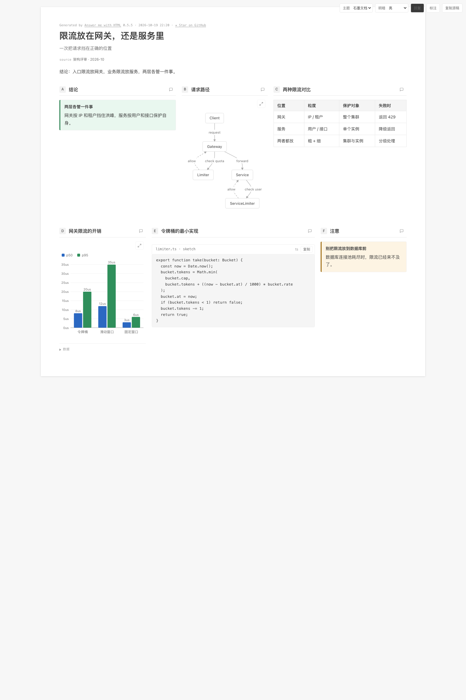

<p align="center">
  
</p>

<h1 align="center">Answer me with HTML in Shimo Style</h1>

<p align="center">
  <b>把复杂问题回答成一页 HTML，默认石墨文档风格。</b>
</p>

<p align="center">
  
</p>

<p align="center">
  <sub>默认浅色主题。运行 <code>am config set mode dark</code>，或用页面右上角工具条切换深色。</sub>
</p>

这是 [QingYunA/answer-me-with-html](https://github.com/QingYunA/answer-me-with-html)（MIT）的 fork：把石墨文档的观感做成
**内置主题，并设为默认主题**。CLI、草稿格式、组件、讲解视频和设置都来自原项目；新增的是石墨主题：
浅灰 `#f7f7f7` 画布上的白色方角纸张、30px/700 文档标题、15px/1.7 正文、中性灰、细线，以及一个可访问的石墨蓝强调色。

## 你会得到什么

- 每个回答一个独立 HTML 文件。装好 skill 后不需要服务器，也不需要再装依赖。
- `shimo` 主题内置且默认生效；`theme: auto` 仍会按内容选择 paper / blueprint。
- 明暗两套配色都通过主题检查（0 错误、0 警告）。
- 表格、代码块、高亮块、流程图 / 时序图 / ER 图、图表、时间线、树和公式都跟随该主题。
- 原功能保留：`am render`、`am patch`、`am video`、STE 写作检查、页面评论与回复闭环。

## 安装

需要 [Node.js](https://nodejs.org/) 20 或更新。不需要 `npm install`：CLI 已经打包在 skill 里。

### 让 Agent 安装

把下面这句话粘贴给 Claude Code、Codex、Cursor、OpenCode 或 DeepSeek Harness：

> 安装 Answer me with HTML in Shimo Style：读取
> https://raw.githubusercontent.com/kanzakivnw/answer-me-with-html-in-Shimo-Style/main/INSTALL.md 并照着做。

### 一条命令

```bash
npx skills add kanzakivnw/answer-me-with-html-in-Shimo-Style
```

安装器（[vercel-labs/skills](https://github.com/vercel-labs/skills)）会询问装到哪些 Agent。

### Claude Code 插件

```
/plugin marketplace add kanzakivnw/answer-me-with-html-in-Shimo-Style
/plugin install answer-me-with-html-in-shimo-style@answer-me-with-html-in-Shimo-Style
```

### DeepSeek Harness 插件

```bash
dsh plugin --profile web add github:kanzakivnw/answer-me-with-html-in-Shimo-Style
```

### 手动安装

```bash
git clone --depth 1 https://github.com/kanzakivnw/answer-me-with-html-in-Shimo-Style.git /tmp/answer-me-with-html-in-shimo-style
cp -R /tmp/answer-me-with-html-in-shimo-style/skills/answer-me-with-html-in-shimo-style ~/.claude/skills/answer-me-with-html-in-shimo-style
```

其他 Agent 的 skill 目录：Codex `~/.codex/skills/`、Cursor `~/.cursor/skills/`、OpenCode
`~/.config/opencode/skill/`、DeepSeek Harness `~/.dsh/skills/`。

## 使用

照常提问：

```
> 讲讲 TCP 三次握手
> Redis 还是 Memcached 做缓存？
> 梳理一下这个仓库的模块关系
```

Agent 会写一份很短的 Markdown 草稿，再调用内置 CLI 生成页面。页面保存在 `~/.answer-me-with-html/pages/`
（与原项目共用同一个数据目录；两个 skill 只装一个，因为设置和页面是共享的）。用浏览器打开即可。

在对话里改设置，或直接运行：

```bash
am config                      # 查看设置；theme 默认 shimo
am config set theme auto       # 按内容自动选主题
am config set theme shimo      # 回到石墨文档风格
am config set mode dark        # 深色
am list                        # 模板、主题、组件
```

页面右上角可以切换主题和明暗、写评论、把回复 Markdown 复制回 Agent。

## 石墨主题

主题参数来自 2026-10 对石墨编辑器的实测：

| 项目 | 取值 |
| :--- | :--- |
| 画布 | `#f7f7f7` |
| 纸张 | 白色、方角、`0 1px 5px rgba(0,0,0,.13)` 阴影 |
| 文档标题 | 30px / 700 |
| 正文 | 15px / 行高 1.7 |
| 灰色 | 正文 `#3a3a3a` / `#6b6b6b` / `#9a9a9a`；细线 `#e7e7e7` |
| 强调色 | `#2b68c2`（链接、高亮、焦点） |
| 表格 | 表头 `#f5f5f5`，1px `#e7e7e7` 边线 |

主题源码在 `src/themes/shimo.js`。如果用户在 `~/.answer-me-with-html/themes/shimo.json` 放了同名主题，会覆盖内置版本；
想用内置版本就不要放这个文件。

## 开发

```bash
npm ci
npm run build     # 重建 skills/answer-me-with-html-in-shimo-style/scripts/am.mjs
npm test
```

`skills/answer-me-with-html-in-shimo-style/scripts/am.mjs` 是生成文件。改 `src/` 后运行 `npm run build`，并把两者一起提交。

## Always-on 模式（可选）

想让每个结论都带一张小页面，把下面这条规则粘贴到 Agent 的规则文件（例如 `CLAUDE.md` 或 `AGENTS.md`）：

> [answer-me-with-html-in-shimo-style always-on] 每次给出结论、总结、计划、对比、评审或解释时，用内置 CLI 生成一张小页面；渲染时加 `--no-open`，回复最后一行按 skill 的 `SKILL.md` 里的格式给出页面链接。

## 致谢与许可

Fork 自 QingYunA 的 [Answer me with HTML](https://github.com/QingYunA/answer-me-with-html)，MIT。
石墨主题、fork 品牌与默认主题改动由 [kanzakivnw](https://github.com/kanzakivnw) 完成。
见 [LICENSE](LICENSE) 与 [NOTICE](NOTICE)。主题可嵌入的 Bangers 字体使用
[SIL Open Font License 1.1](skills/answer-me-with-html-in-shimo-style/licenses/OFL-Bangers.txt)。
