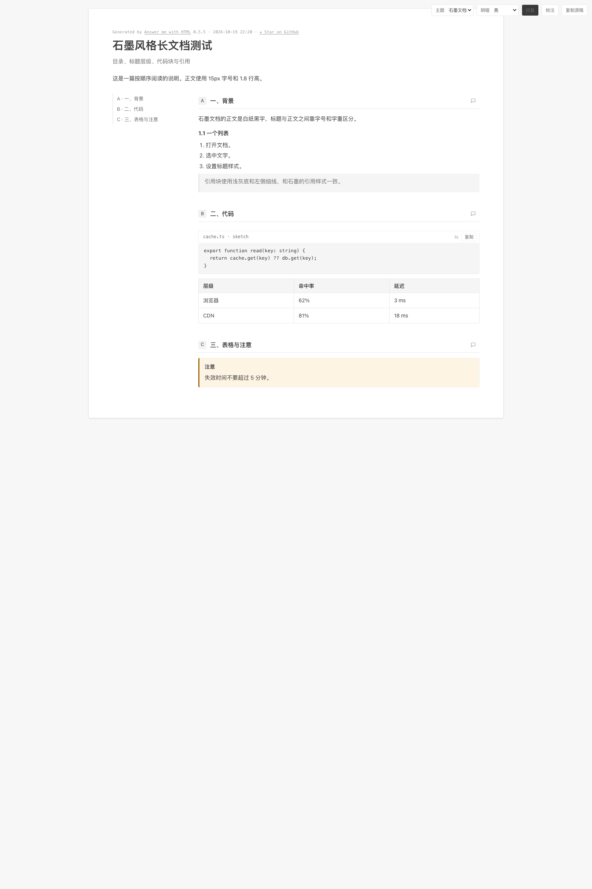
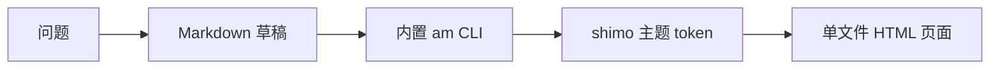

<p align="right">
  <a href="./README.md">English</a> · <strong>简体中文</strong>
</p>

<p align="center">
  
</p>

<h1 align="center">Answer me with HTML<br>in Shimo Style</h1>

<p align="center">
  <b>把复杂问题，回答成一页石墨文档风格的 HTML。</b><br>
  <sub>模型只写 Markdown 草稿，CLI 负责排版、配色与图示。单文件、离线、无需服务器。</sub>
</p>

<p align="center">
  <a href="https://github.com/kanzakivnw/answer-me-with-html-in-Shimo-Style/releases"></a>
  <a href="https://github.com/kanzakivnw/answer-me-with-html-in-Shimo-Style/blob/main/LICENSE"></a>
  
  
  <a href="https://kanzakivnw.github.io/answer-me-with-html-in-Shimo-Style/"></a>
</p>

<p align="center">
  <a href="https://kanzakivnw.github.io/answer-me-with-html-in-Shimo-Style/"><b>在线演示</b></a> ·
  <a href="#-安装"><b>安装</b></a> ·
  <a href="#-石墨配色"><b>主题</b></a> ·
  <a href="#-开发"><b>开发</b></a>
</p>

<p align="center">
  
</p>

<p align="center">
  <sub>内置 <code>shimo</code> 主题。运行 <code>am config set mode dark</code>，或用页面右上角工具条切换深色。</sub>
</p>

## 为什么 fork？

[Answer me with HTML](https://github.com/QingYunA/answer-me-with-html) 已经能把 Markdown 草稿变成干净的 HTML 页面。
这个 fork 新增了一个**项目原生的石墨文档主题**，并把它设为默认，让页面看起来像一份真正会被人读完的文档。

| | 原项目 | 这个 fork |
| :--- | :--- | :--- |
| CLI、草稿、组件、视频 | ✅ | ✅ 原样保留 |
| 主题 | blueprint · shadcn · paper · 3b1b | 新增 **`shimo`**，内置且默认 |
| 观感 | 技术图纸 / 卡片 / 纸张 | `#f7f7f7` 上的白色方角纸张、30px/700 标题、15px/1.7 正文 |
| 质量 | — | `0 errors · 0 warnings`，通过 WCAG AA 对比度 |

## ✨ 功能

| 功能 | 你会得到什么 |
| :--- | :--- |
| 🎨 **默认石墨风格** | 白色纸张、细灰线、中性灰，以及一个可访问的石墨蓝。 |
| 📄 **单文件、离线** | 输出是一个内联 CSS / JS 的 HTML 文件，不需要服务器，也不请求 CDN。 |
| 🧩 **真实组件** | 表格、代码块、高亮块、流程图 / 时序图 / ER 图、图表、时间线、树和公式。 |
| 🌗 **明暗双配色** | 两套色板都由 token 驱动，并通过主题的对比度检查。 |
| ⚡ **快** | 模型只写很短的 Markdown 草稿；排版和 SVG 坐标由内置 CLI 完成。 |
| 🧪 **写作检查** | STE 检查会标记冗长句子和过长段落，再生成页面。 |

## 🚀 安装

需要 [Node.js](https://nodejs.org/) 20 或更新。不需要 `npm install`：CLI 已经打包在 skill 里。

### 让 Agent 安装

把下面这句话粘贴给 Claude Code、Codex、Cursor、OpenCode、DeepSeek Harness 或其他 Agent：

> 安装 Answer me with HTML in Shimo Style：读取
> https://raw.githubusercontent.com/kanzakivnw/answer-me-with-html-in-Shimo-Style/main/INSTALL.md 并照着做。

### 一条命令

```bash
npx skills add kanzakivnw/answer-me-with-html-in-Shimo-Style
```

安装器（[vercel-labs/skills](https://github.com/vercel-labs/skills)）会询问装到哪些 Agent。

### Claude Code 插件

```
/plugin marketplace add kanzakivnw/answer-me-with-html-in-Shimo-Style
/plugin install answer-me-with-html-in-shimo-style@answer-me-with-html-in-Shimo-Style
```

### DeepSeek Harness 插件

```bash
dsh plugin --profile web add github:kanzakivnw/answer-me-with-html-in-Shimo-Style
```

<details>
<summary><b>手动安装</b></summary>

```bash
git clone --depth 1 https://github.com/kanzakivnw/answer-me-with-html-in-Shimo-Style.git /tmp/answer-me-with-html-in-shimo-style
cp -R /tmp/answer-me-with-html-in-shimo-style/skills/answer-me-with-html-in-shimo-style ~/.claude/skills/answer-me-with-html-in-shimo-style
```

其他 Agent 的 skill 目录：Codex `~/.codex/skills/`、Cursor `~/.cursor/skills/`、OpenCode
`~/.config/opencode/skill/`、DeepSeek Harness `~/.dsh/skills/`。

</details>

## 🧩 使用

照常提问：

```
> 讲讲 TCP 三次握手
> Redis 还是 Memcached 做缓存？
> 梳理一下这个仓库的模块关系
```

Agent 会写一份很短的 Markdown 草稿，再调用内置 CLI 生成页面。页面保存在 `~/.answer-me-with-html/pages/`
（与原项目共用同一个数据目录；两个 skill 只装一个，因为设置和页面是共享的）。用浏览器打开即可。

在对话里改设置，或直接运行：

```bash
am config                      # 查看设置；theme 默认 shimo
am config set theme auto       # 按内容自动选主题
am config set theme shimo      # 回到石墨文档风格
am config set mode dark        # 深色
am list                        # 模板、主题、组件
```

页面右上角可以切换主题和明暗、写评论、把回复 Markdown 复制回 Agent。

## 🎨 石墨配色

主题参数来自 2026-10 对石墨编辑器的实测。下面这些 token 就是主题实际检查并发布的同一套值。

| 项目 | 取值 | 出现位置 |
| :--- | :--- | :--- |
| 画布 | `#f7f7f7` | 页面背景 |
| 纸张 | `#ffffff` + `0 1px 5px rgba(0,0,0,.13)` | 方角页面与轻阴影 |
| 标题 / 正文 | `30px/700` · `15px/1.7` | 文档标题与正文 |
| 文字 | `#3a3a3a` · `#6b6b6b` · `#9a9a9a` | 正文、次要文字、元信息 |
| 细线 | `#e7e7e7` · `#efefef` | 表格边线与分隔线 |
| 填充 | `#f5f5f5` | 表头、代码块、行内代码 |
| 强调色 | `#2b68c2` | 链接、焦点、高亮 |
| 图示 | `#d5dae1` 描边 · `#eaf2fe` 高亮 | 流程图、时序图、ER 图、图表 |

主题源码在 [`src/themes/shimo.js`](src/themes/shimo.js)。如果用户在 `~/.answer-me-with-html/themes/shimo.json` 放了同名主题，
会覆盖内置版本；想用内置版本就不要放这个文件。

<details>
<summary><b>文档模板预览</b></summary>

<p align="center">
  
</p>

</details>

## 🔄 工作方式



模型不写 HTML、CSS 或 SVG。它只写草稿；排版、配色、明暗、图示坐标和写作检查都由 CLI 负责。

## 📁 项目结构

```text
skills/answer-me-with-html-in-shimo-style/   skill：SKILL.md、references 和打包好的 CLI
src/themes/shimo.js                          石墨主题源码（会被打进 CLI）
demo/                                        GitHub Pages 演示（index.md → index.html）
.github/workflows/pages.yml                  渲染 demo 并部署到 Pages
```

## 🛠 开发

```bash
npm ci
npm run build     # 重建 skills/answer-me-with-html-in-shimo-style/scripts/am.mjs
npm test
```

`skills/answer-me-with-html-in-shimo-style/scripts/am.mjs` 是生成文件。改 `src/` 后运行 `npm run build`，并把两者一起提交。

## ⚖️ 致谢与许可

Fork 自 QingYunA 的 [Answer me with HTML](https://github.com/QingYunA/answer-me-with-html)，MIT。
石墨主题、fork 品牌与默认主题改动由 [kanzakivnw](https://github.com/kanzakivnw) 完成。
见 [LICENSE](LICENSE) 与 [NOTICE](NOTICE)。主题可嵌入的 Bangers 字体使用
[SIL Open Font License 1.1](skills/answer-me-with-html-in-shimo-style/licenses/OFL-Bangers.txt)。

<p align="center">
  <sub>如果这个 skill 让你的回答更好读，点一个 ⭐ 能帮更多人找到它。</sub>
</p>
